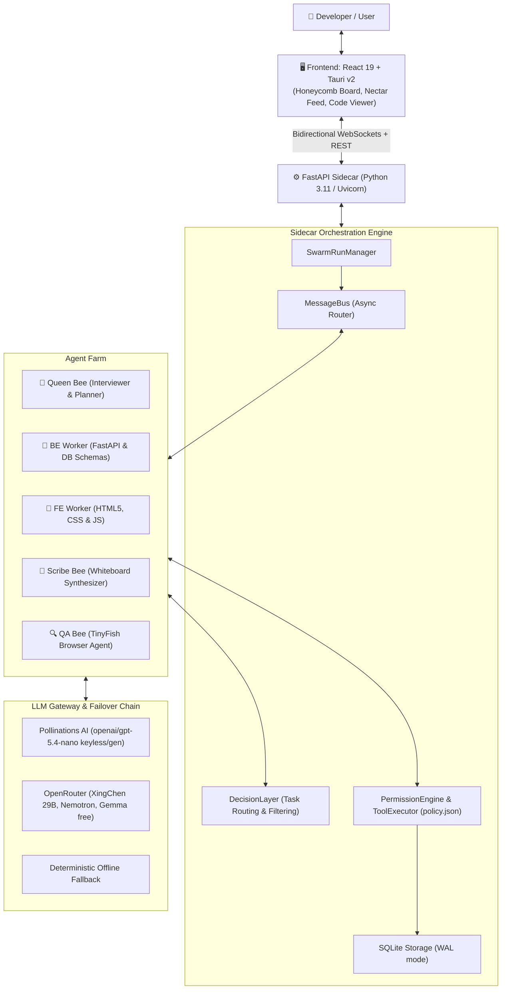

# Swarm 🐝

> **A desktop multi-agent software engineering farm that builds, verifies, and refactors code in the open with real-time human steering.**

[](LICENSE)
[](https://www.python.org/)
[](https://fastapi.tiangolo.com/)
[](https://v2.tauri.app/)
[](https://react.dev/)
[](sidecar/tests/)

Built for **HackIIITD** (Esya '26, IIIT Delhi) • Powered by **TinyFish**.

---

## 💡 The Problem & The Swarm Solution

| Traditional AI Coding Tools | The Swarm Approach |
| :--- | :--- |
| **Opaque Black Box**: Developers cannot see what multi-agent teams are deciding or why. | **Honeycomb Whiteboard**: High-level, plain-language **Honey Cards** updated live as work happens. |
| **Stale Memory**: Models hallucinate outdated library syntax and APIs. | **TinyFish Live Research**: Research bees fetch real-time web documentation and references before writing code. |
| **Unverified Deliveries**: Code is marked "done" without executing in a real environment. | **Browser QA with Proof**: QA bees launch headless browsers, submit forms, and report screenshot evidence. |
| **All-or-Nothing Control**: Hard to interrupt or guide agents once started. | **Mid-Run Steering & Diff Approvals**: Steer, queue, or interrupt agents live with visual Git diffs. |

---

## ⚡ Key Features

- **👑 Queen Bee Discovery with Interactive MCQs**: Conducts structured discovery interviews, outputs tailored Multiple Choice Question (MCQ) chips in the feed, and decomposes goals into parallel tasks.
- **🐝 Collaborative Worker Farm**:
  - **Backend Worker**: Generates FastAPI routes (`/api/register`, `/api/waitlist`) with dynamic JSON schema validation.
  - **Frontend Worker**: Generates responsive HTML5, amber honeycomb CSS variables, and fetch integration.
  - **Asynchronous Contract Locking**: BE and FE workers exchange and lock API schema contracts across the message bus.
- **📜 Scribe Bee & Honeycomb Whiteboard**:
  - Automatically filters raw agent conversation ("nectar") using a decision layer and synthesizes clean progress updates ("honey") onto the dashboard.
- **🎯 Full Local Repository Agent Harness**:
  - **Attach to Any Repo**: Point Swarm to existing codebases via `SWARM_PROJECT_ROOT` or `--project-dir`.
  - **Targeted Diff Editing (`file_edit`)**: Exact search-and-replace patching with atomic replacement—no destructive file overwrites.
  - **Codebase Exploration**: Windowed file reading (`file_read`), folder tree listing (`list_directory`), and fast regex symbol search (`search_code`).
  - **Self-Correcting Test Loop**: Automatically runs `pytest`, `npm test`, or `SWARM_TEST_COMMAND`, diagnoses tracebacks, and self-heals up to 3 cycles.
- **🛡️ Deterministic Permission Policy & Auditing**:
  - Central `ToolExecutor` enforcing risk tiers (`ALLOW`, `GATE`, `FORBIDDEN`).
  - Automatic redaction of credentials, API keys, `.env*`, and SSH keys from logs and storage.
  - Complete audit ledger of every tool call, latency, and provenance (`real` vs `simulated`) stored in SQLite WAL.
- **🔍 Live Unified Git Diff & Revert Gate**:
  - Preview exact red/green code modifications (including brand-new untracked files) directly inside the Approval Gate modal before authorizing changes.
  - Supports **Approve & Apply** or **Reject & Revert** (via recoverable `git stash`).
- **🌐 TinyFish Web Grounding & Gauntlet QA**:
  - Grounding via TinyFish Search & Fetch APIs.
  - Gauntlet browser suite testing 4 personas: Mobile, Messy Input, Double-Submit, and Malformed Payload with HTML audit reports.

---

## 🏗️ Architecture



---

## 🚀 Quickstart

### Prerequisites
- **Python 3.11+**
- **Node.js 18+** & npm
- *(Optional for Desktop packaging)* [Rust & Cargo](https://rustup.rs/) (for Tauri v2 desktop mode)

---

### 1. Installation

```bash
# Clone the repository
git clone https://github.com/simplychiragk/swarm.git
cd swarm

# Install Python dependencies
python -m pip install -r sidecar/requirements.txt

# Install Frontend dependencies
npm --prefix app install
```

---

### 2. Environment Setup

Copy `.env.example` to `.env`:

```bash
cp .env.example .env
```

Configure your preferred runtime modes and keys:

```dotenv
# Runtime mode: 'live' (agent farm) or 'mock' (offline demo playback)
SWARM_MODE=live
SWARM_LLM_MODE=live

# Optional: Attach Swarm to an existing repository on your machine
# SWARM_PROJECT_ROOT=C:\path\to\your-project

# Free keyless Pollinations AI or OpenRouter API Key
OPENROUTER_API_KEY=your_key_here

# TinyFish Live Web Research & Browser QA API Key (optional for web QA)
TINYFISH_API_KEY=your_key_here
```

---

### 3. Launching Swarm

#### Terminal 1 — Start the FastAPI Sidecar
```bash
# Starts sidecar on http://127.0.0.1:8000
npm run sidecar
```

#### Terminal 2 — Start the User Interface

**Option A: Desktop App (Tauri v2)**
```bash
npm run app
```

**Option B: Web Browser Mode (Fast iteration)**
```bash
npm run app:web
# Open http://localhost:1420 in your browser
```

---

## 🛠️ Attaching Swarm to an Existing Project

Swarm can act as an autonomous coding copilot on any folder on your machine:

```powershell
# Point Swarm to an existing repository via environment variable:
$env:SWARM_PROJECT_ROOT = "C:\Users\you\Desktop\Projects\my-app"
npm run sidecar
```

Or via CLI flag:
```bash
python -m uvicorn sidecar.main:app --host 127.0.0.1 --port 8000 --project-dir "/path/to/my-app"
```

1. Ask Swarm to build a feature or fix a bug in the chat feed.
2. Workers use `search_code` and `file_read` to inspect your existing files.
3. Workers generate targeted `file_edit` diffs (preserving formatting and context).
4. Workers run your project's test suite (`pytest` or `npm test`) to verify their changes.
5. Review the syntax-highlighted **Git Diff** in the Honeycomb UI and click **Approve & Apply**.

---

## 🐝 Swarm Agent Roles

| Agent | Icon | Role & Responsibility | Output Artefacts |
| :--- | :---: | :--- | :--- |
| **Queen Bee** | 👑 | Discovery interviews (interactive MCQs), parallel task decomposition, watchdog health monitoring, failure routing. | Structured Task Plan, `PlanDiff`, Whiteboard Cards |
| **Backend Worker** | 🐝 | Constructs FastAPI routes, database models, validators, and locks API contracts for peers. | `api/main.py`, API contract specifications |
| **Frontend Worker** | 🐝 | Builds responsive HTML5 interfaces, amber CSS themes, form handling, and fetch clients matching backend contracts. | `index.html`, `style.css`, `app.js` |
| **Scribe Bee** | 📜 | Subscribes to live developer chatter, filters noise using the decision layer, and posts plain-language summary cards. | Honeycomb Whiteboard Cards |
| **Research Bee** | 🔍 | Queries the live web via TinyFish Search & Fetch to ground workers with fresh API docs before code generation. | Grounding Evidence & Research Summaries |
| **QA Bee** | 🧪 | Launches headless browser instances via TinyFish Browser Agent, fills forms, verifies HTTP 201s, and captures screenshot proof. | Verification Verdict (`PASS`/`FAIL`), Screenshots |

---

## 📋 Environment Variables Reference

| Variable | Description | Default |
| :--- | :--- | :--- |
| `SWARM_MODE` | Sidecar execution mode: `live` or `mock`. | `mock` |
| `SWARM_PROJECT_ROOT` | Path to existing user repository to edit live on disk. | `""` *(uses `workspace/<run_id>/`)* |
| `SWARM_TEST_COMMAND` | Custom test command for self-correcting verification loops. | Auto-detected (`pytest` / `npm test`) |
| `SWARM_MAX_FIX_RETRIES` | Max self-correction attempt cycles before escalating. | `3` |
| `SWARM_SIDECAR_PORT` | HTTP and WebSocket port for the FastAPI sidecar. | `8000` |
| `SWARM_LLM_MODE` | Gateway mode: `live` (LLMs) or `mock` (deterministic stub). | `mock` |
| `POLLINATIONS_API_KEY` | Optional API key for `gen.pollinations.ai` (runs keyless by default). | `""` |
| `OPENROUTER_API_KEY` | OpenRouter key for XingChen 29B, Nemotron, or Gemma free tiers. | `""` |
| `TINYFISH_API_KEY` | TinyFish API key for live search, doc fetch, and browser QA. | `""` |
| `ENABLE_TINYFISH_BEES` | Enable live TinyFish Research and QA bees. | `false` |

---

## 🧪 Testing & Verification

Swarm includes a comprehensive test suite covering agent communication, decision layers, permission gates, and targeted diff operations:

```bash
# Run unit & integration test suite (80 passed)
py -3.11 -m pytest sidecar/tests -q

# Run headless mock pipeline verification (< 15s budget)
python scripts/e2e_mock.py

# Verify TypeScript and Vite production frontend build
npm --prefix app run build
```

---

## 📚 Project Documentation

- **[System Architecture](docs/ARCHITECTURE.md)**: Exhaustive technical blueprint, 5-layer design, and data flow from user interaction to whiteboard card updates.
- **[WebSocket Contracts](docs/CONTRACT.md)**: Precise JSON event envelope specs for client/server streaming.
- **[Permissions & Safety Policy](docs/PERMISSIONS.md)**: Security policy, sandbox boundaries, and tool tier classifications.
- **[Runbook & Operational Guide](docs/RUNBOOK.md)**: Troubleshooting, streaming flags, and environment configurations.
- **[Development Progress Log](docs/PROGRESS.md)**: Chronological stage-by-stage engineering log.
- **[3-Minute Demo Video Script](docs/VIDEO_SCRIPT_3MIN.md)**: Second-by-second presenter script and screen recording cues.
- **[Pitch Deck Specification](docs/PITCH_DECK_8SLIDES.md)**: 8-slide architecture and technical breakdown.

---

## 👥 The Team

Crafted with ❤️ for **HackIIITD** (Esya '26, IIIT Delhi) by:

- **Chirag Kumar** ([@simplychiragk](https://github.com/simplychiragk))
- **Tanmay Sharma**
- **Priyanshu Tiwari**

---

## 📄 License

This project is licensed under the [MIT License](LICENSE).
