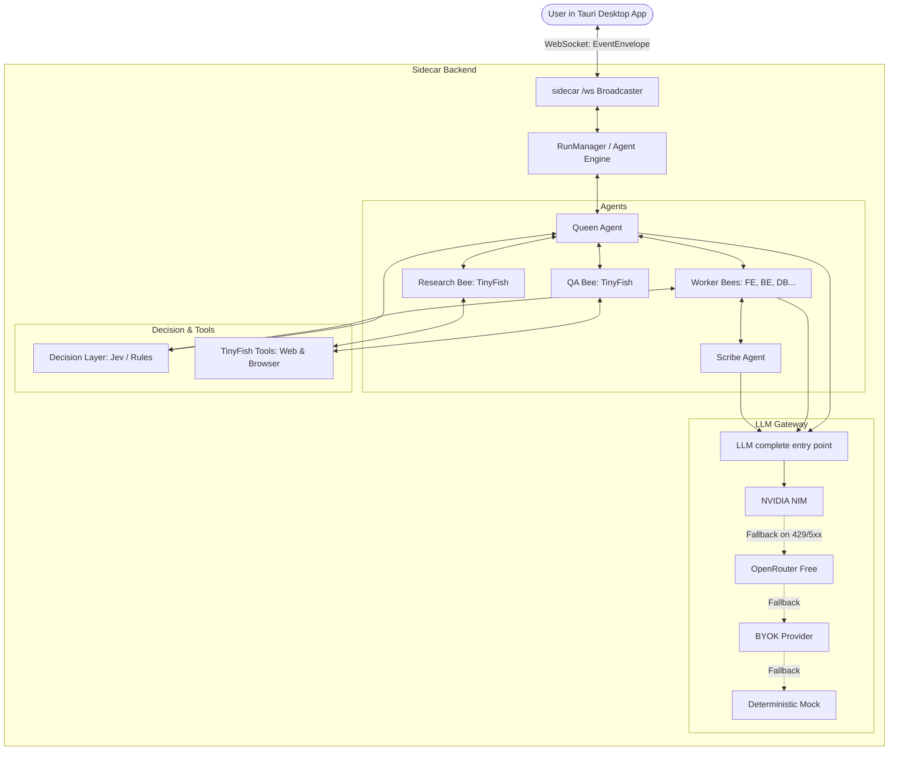

# Swarm Architecture Overview

Swarm provides a transparent, verifiable multi-agent development environment. This document describes the 5-layer system design, the data flow from user interaction to whiteboard card updates, and the module responsibilities within the backend sidecar.

---

## The Five Layers

1. **Interface Layer (`app/`)**: Tauri v2 desktop application running React, Tailwind, and Shadcn/ui. Displays the live Honeycomb Whiteboard and agent chatter feed.
2. **Orchestration Layer (`sidecar/runtime/`, `sidecar/agents/`)**: Custom async agent farm (no heavy frameworks). Coordinates the Queen, Workers, Scribe, and QA/Research bees via an in-process message bus.
3. **Decision Layer (`sidecar/decision/`)**: Pluggable decision engine (Jev / rule-based fallback). Provides structured decisions for task routing across lanes, approval gating, and whiteboard filtering.
4. **Tools Layer (`sidecar/tools/`)**: TinyFish integration for live web research (Search & Fetch) and end-to-end browser QA with screenshot verification.
5. **Model Gateway (`sidecar/llm/`)**: Multi-provider LLM gateway with automated priority fallback (NVIDIA NIM -> OpenRouter -> BYOK -> Mock).

---

## System Architecture Diagram

---

## Data Flow: From User Prompt to Whiteboard Honey

1. **User Input (`user_message`)**: The user submits a prompt (e.g. *"Build a landing page with a waitlist form"*).
2. **Queen Interview & Plan**:
   - The Queen asks clarifying questions to lock requirements.
   - Once requirements are locked, the Queen requests a structured task plan via `complete(json_schema=...)`.
   - Tasks are routed to lanes (`FE`, `BE`, `Test`, `Ops`) via the Decision Layer (`route_task`).
3. **Worker Execution (Nectar Feed)**:
   - Workers pick up delegated tasks and converse over the in-process message bus.
   - Raw chatter and task status updates (`feed_message`) are immediately forwarded via the WebSocket broadcaster to the desktop app feed.
4. **Scribe Summarization (Honey Cards)**:
   - The Scribe monitors the message bus and batches recent worker nectar.
   - Every few seconds, the Scribe uses the LLM gateway with a card schema to produce a clean, plain-language card summary (`card_upsert`).
   - The card is sent over WebSocket to populate the Honeycomb Whiteboard in the UI.
5. **Verification & Approval Gate**:
   - QA Bee tests the site and attaches evidence (e.g. test logs or screenshots) to the whiteboard card.
   - If an action involves production deployment, the Decision Layer marks the card as `needs_approval` and issues an `approval_request`.
   - The user clicks **Approve** or **Redirect** (`approval_response`), steering the swarm to completion or revision.

---

## Sidecar Module Breakdown

| Module | Purpose / Responsibilities | Dependencies |
|---|---|---|
| `sidecar/models/` | Canonical Pydantic models matching shared JSON schemas. Handles event envelope validation and deserialization. | `pydantic` |
| `sidecar/broadcaster.py` | Manages active WebSocket connections, message broadcast, and in-memory event replay buffer. | `fastapi`, `pydantic` |
| `sidecar/mock_runner.py` | Generates a deterministic simulated run of the Section 9 waitlist landing page scenario. | `sidecar/models`, `sidecar/broadcaster` |
| `sidecar/decision/` | Abstract `DecisionLayer` interface and `RuleBasedDecisionLayer` heuristic engine (Jev stub). | `sidecar/models` |
| `sidecar/runtime/` | Orchestration lifecycle interfaces (`RunManager`, `NoOpRunManager`). | `sidecar/models` |
| `sidecar/llm/` | Unified LLM completion gateway, provider fallback chain, cooldowns, and structured output validator. | `httpx`, `pydantic` |
| `sidecar/agents/` | Multi-agent execution engine (Queen, Workers, Scribe) and message bus (Stage 3). | `sidecar/llm`, `sidecar/decision`, `sidecar/broadcaster` |
| `sidecar/tools/` | TinyFish Search, Fetch, and Browser Agent integration (Stage 4). | `httpx` |
| `sidecar/main.py` | FastAPI application exposing `/health`, `/ws`, `/mock/*`, and decision test routes. | `fastapi`, `uvicorn`, all sidecar modules |
