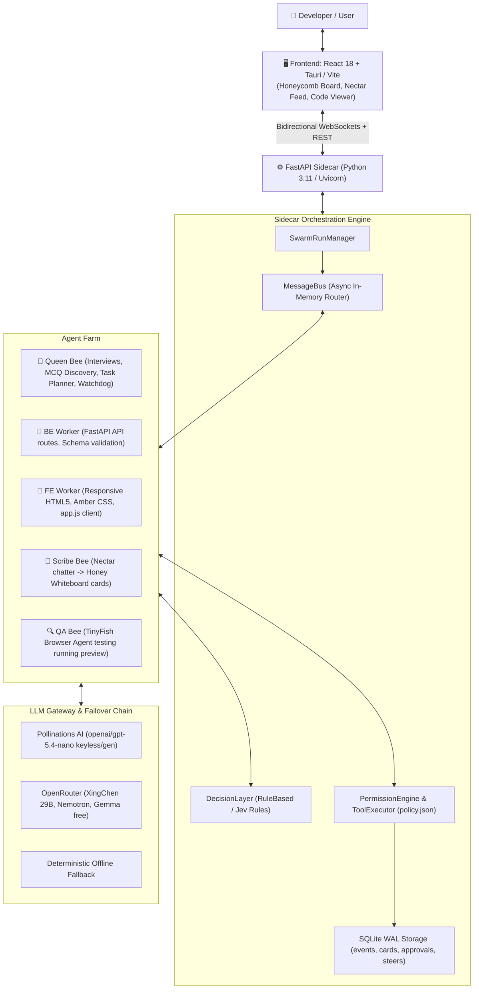
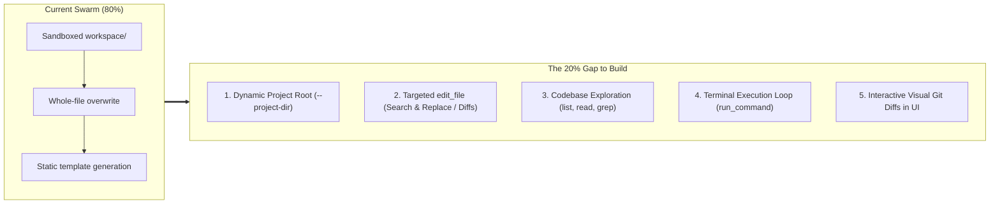
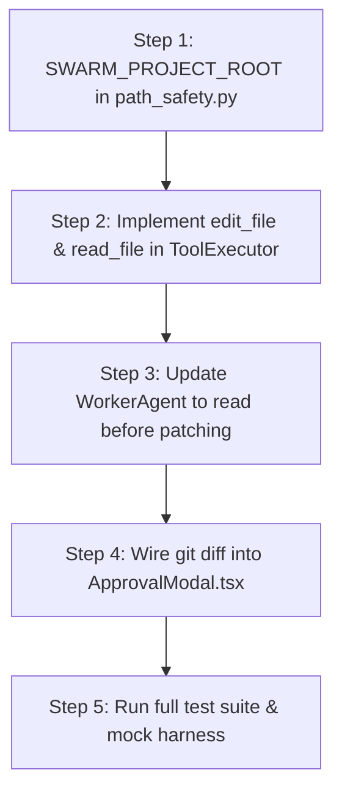

# 🐝 Swarm: Master Architecture, Context & 20% Gap Handover Specification

> **Target Audience**: Incoming AI Coding Agents & Engineers.  
> **Purpose**: Single source of truth containing 100% of the project context, historical implementations, bug fixes, and exact instructions for bridging the remaining 20% gap to make Swarm a real-time local codebase agent harness.

---

## 1. Executive Summary & Core Philosophy

**Swarm** (formerly "Hive") is a desktop multi-agent software engineering environment built for **HackIIITD** (Esya '26, IIIT Delhi, final 24-hour round, 24–25 Oct 2026).

### The Core Problem
Traditional AI coding tools (and black-box multi-agent frameworks) are opaque, memory-stale, and unverified:
1. **Opaque decisions**: Developers cannot see why an agent made an architectural or routing choice.
2. **Stale model assumptions**: Agents hallucinate deprecated APIs and syntax.
3. **Unverified deliveries**: Code is claimed "done" without running a real browser or executing a test suite.
4. **All-or-nothing control**: No deterministic safety gates or human steering during the build.

### The Swarm Solution
- **Visibility**: A real-time **Honeycomb Whiteboard** displaying plain-language **Honey Cards** updated continuously.
- **Freshness**: Live web grounding via **TinyFish API** (Search & Fetch before build).
- **Verification**: Autonomous browser verification via **TinyFish Browser Agent** reporting pass/fail with screenshots.
- **Control**: Real-time human steering (`steer`, `queue`, `interrupt`) and human-in-the-loop approval gates.
- **Auditing**: Deterministic permission policy engine recording every tool call, latency, and provenance (`real` vs `simulated`) into SQLite.

---

## 2. System Architecture & High-Level Topology



---

## 3. Vocabulary & Domain Terminology

| Term | Exact Meaning in Codebase | Key Files |
| :--- | :--- | :--- |
| **Swarm** | The overarching system and multi-agent farm. | `sidecar/main.py`, `sidecar/agents/run_manager.py` |
| **Queen** | The lead agent. Conducts discovery interviews, creates plans, monitors health, routes failures. | `sidecar/agents/queen.py` |
| **Worker Bee** | Domain execution agents (`be_worker`, `fe_worker`). Write files and exchange contracts. | `sidecar/agents/worker.py` |
| **Scribe** | Summarizes raw chatter into clean progress cards. | `sidecar/agents/scribe.py` |
| **Nectar** | Raw chat stream exchanged between agents and the user. | `app/src/components/Sidebar.tsx` (`.feed-message`) |
| **Honey** | Synthesized milestone cards displayed on the whiteboard. | `sidecar/models/contracts.py` (`WhiteboardCard`) |
| **Honeycomb Whiteboard**| Hexagonal/retro dashboard visualizing cards across lanes (`FE`, `BE`, `TEST`, `OPS`). | `app/src/components/HoneycombWhiteboard.tsx` |
| **Lanes** | Domain classification: `FE`, `BE`, `TEST`, `OPS`, `NONE`. | `sidecar/models/contracts.py` (`Lane`) |
| **Decision Layer** | Heuristic/Jev-style engine: routes tasks, gates approvals, filters whiteboard noise. | `sidecar/decision/layer.py` |
| **TinyFish** | Live web search, doc fetch, and browser QA execution. | `sidecar/tools/tinyfish.py` |
| **Gauntlet** | Multi-persona autonomous browser test suite (Mobile, Messy, Double-submit, Malformed). | `sidecar/agents/gauntlet.py` |

---

## 4. Current State: What is 100% Implemented & Ready

### 4.1 Backend Engine & Sidecar (`sidecar/`)
1. **Interactive MCQ Discovery (`sidecar/agents/queen.py`)**:
   - The Queen evaluates user input up to a 3-question limit.
   - Outputs structured schema `InterviewEvaluation` including `options: List[str]`.
   - Generates 3–4 contextual options per question with reliable fallback heuristics.
   - Emits `metadata={"options": [...]}` in WebSocket chat packets.
2. **Parallel Worker Farm (`sidecar/agents/worker.py`)**:
   - `BE Worker`: Generates working FastAPI routes (`/api/register`, `/api/waitlist`) with dynamic request schema validation.
   - `FE Worker`: Generates complete responsive HTML5 markup, amber honeycomb styling, and form fetch clients.
   - Asynchronous contract negotiation: BE Worker broadcasts locked API endpoints (`POST /api/register -> Request/Response`); FE acknowledges and matches its fetch calls.
3. **Multi-Provider LLM Gateway (`sidecar/llm/gateway.py`)**:
   - Primary: **Pollinations AI** (`openai/gpt-5.4-nano`). Direct keyless access via `https://text.pollinations.ai/` with `jsonMode: true`.
   - Secondary: **OpenRouter** (`xingchen-agi/xing4.0-29b-a4b`, `nvidia/nemotron-3.5-lightning:free`, `google/gemma-4-26b-a4b-it:free`).
   - Resiliency: 3-strike failure circuit breaker with 60s cooldown, structured JSON repair prompts, and deterministic mock completion fallback.
4. **Permission Engine & ToolExecutor (`sidecar/permissions/`)**:
   - Enforces deterministic policy from `policy.json`.
   - Categorizes tools into `ALLOW`, `GATE` (human approval needed), and `FORBIDDEN` (e.g. `.env`, private keys).
   - Fully redacts API keys, credentials, and secrets from all logs and storage.
   - Records every tool invocation with exact execution latency and provenance (`real` vs `simulated`).
5. **Real-time Event Streaming (`sidecar/broadcaster.py`)**:
   - Bidirectional WebSocket (`/ws`) broadcasting:
     - `feed_message` (nectar chatter and streaming token deltas)
     - `card_upsert` (honeycomb whiteboard cards)
     - `approval_request` & `approval_response` (interactive human-in-the-loop gates)
     - `plan_diff` (real-time steering diffs)
   - Sequenced event catch-up for reconnecting clients via `?after_seq=<seq>`.
6. **SQLite WAL Persistence (`sidecar/storage/db.py`)**:
   - Tables for `events`, `cards`, `feeds`, `approvals`, `steers`, `tool_records`, and `delivery_decisions`.
   - Thread-safe using `threading.RLock` and WAL mode (`busy_timeout=5000`).

### 4.2 Frontend Application (`app/`)
1. **Honeycomb Whiteboard (`app/src/components/HoneycombWhiteboard.tsx`)**:
   - Visualizes live cards organized by lane columns.
   - Displays real-time progress badges (`PLANNED`, `IN_PROGRESS`, `DONE`, `NEEDS_APPROVAL`).
   - Detailed proof modal showing tool logs and browser screenshots.
2. **Nectar Feed with Interactive MCQ Chips (`app/src/components/Sidebar.tsx`)**:
   - Renders interactive option chips (`[A]`, `[B]`, `[C]`) directly within Queen Bee messages.
   - Dedicated `[ ✏️ Type your own answer... ]` chip that automatically focuses the input box.
   - Single-click answering without manual typing.
3. **Code Viewer Modal (`app/src/components/FileViewerModal.tsx`)**:
   - Real-time directory tree loaded via `GET /workspace/tree`.
   - Syntax-highlighted code editor with direct file save back to the workspace.
4. **Approval Gate Modal (`app/src/components/ApprovalModal.tsx`)**:
   - Interactive prompt with "Approve Deployment" vs "Redirect / Revise" buttons.
   - Scrubbed replay protection so approved cards never reappear on page refresh.

---

## 5. Post-Mortem of Solved Errors & Traps

Incoming agents MUST understand these past failure modes to avoid regressing:

### Trap 1: SQLite OperationalError (Database Locked)
- **Symptom**: `sqlite3.OperationalError: database is locked` on concurrent agent writes.
- **Root Cause**: Python's `sqlite3` in multi-threaded async servers deadlocks if using non-reentrant locks or standard rollback journals.
- **Fix**: Upgraded `sidecar/storage/db.py` to `threading.RLock()`, enabled `PRAGMA journal_mode=WAL;`, and set `PRAGMA busy_timeout=5000;`.

### Trap 2: Agent Message Limit Guards
- **Symptom**: `Agent 'queen' exceeded maximum message limit (20). Halting.`
- **Root Cause**: `max_messages` was hardcoded to 20 across agents, causing crashes during multi-step interviews.
- **Fix**: Set `max_messages=200` by default across all agents and wrapped message emissions in graceful try/except blocks.

### Trap 3: Uvicorn WatchFiles Workspace Crash Loop
- **Symptom**: Writing `workspace/run-default/api/main.py` killed and restarted Uvicorn midway through a build.
- **Root Cause**: Uvicorn watched the entire project root (`--reload`), so code written by worker agents triggered server reload.
- **Fix**: Constrained reload strictly to `uvicorn sidecar.main:app --reload-dir sidecar`.

### Trap 4: Silent Watchdog Infinite Nudge Loop
- **Symptom**: After the user approved deployment, Queen logged `Worker 'BE' silent >20s. Nudging.` endlessly for 7+ minutes, causing Scribe to spam LLM calls.
- **Root Cause**: The watchdog loop never checked if the run was completed or if workers were idle with no active tasks.
- **Fix**: Added `is_completed = True` on approval resolution, cancelled `_watchdog_task`, and restricted watchdog checks strictly to workers with active `active_task_id`.

### Trap 5: Duplicate Task Execution & Contract Storms
- **Symptom**: Workers executed tasks up to 18 times in parallel and spammed the feed with duplicate API contracts.
- **Root Cause**: Workers listened to bus `MessageType.TASK` while the orchestrator also directly called `execute_task()`, without deduplicating task IDs.
- **Fix**: Introduced `self.completed_tasks: Set[str]` and `self._broadcasted_contracts: Set[str]` inside `WorkerAgent`. Duplicate task IDs are skipped immediately.

### Trap 6: Pollinations 401 & 402 Handling
- **Symptom**: Every Pollinations call logged `401 Unauthorized` before succeeding on fallback, and rapid bursts hit `402 Payment Required`.
- **Root Cause**: The gateway was attempting `gen.pollinations.ai` even when no API key was provided.
- **Fix**: Added `if api_key:` check before attempting `gen.pollinations.ai`, routing keyless requests straight to `text.pollinations.ai`, with immediate fallthrough to OpenRouter on 402.

---

## 6. The 20% Gap: Turning Swarm into a Full Local Coding Agent Harness

Right now, Swarm generates **greenfield projects into a sandboxed folder** (`workspace/run-default/`).  
To make Swarm a **true local coding agent harness** (like Claude Code, Cursor, Aider, or Devin) that can open **any existing repo** on your machine and edit code live in response to user prompts, the following 5 components must be built:



---

### Gap 1: Configurable Project Root (Escape the Sandbox)

#### Current Limitation
- In `sidecar/permissions/path_safety.py`, `get_run_workspace(run_id)` hardcodes the target directory to `<repo_root>/workspace/<run_id>/`.
- Any file path outside `workspace/` raises `PathSafetyError("Access Denied: Path escapes run workspace")`.

#### Required Implementation
1. Add environment variable `SWARM_PROJECT_ROOT` and CLI argument `--project-dir <path>`.
2. When specified, `get_run_workspace()` resolves to the user's chosen folder (e.g. `C:\Users\CHIRAG\Desktop\Projects\my-react-app`).
3. Update `path_safety.py` safety boundaries:
   - Safe root = `SWARM_PROJECT_ROOT`.
   - Retain strict blocks on sensitive files: `.env*`, `*.pem`, `*.key`, `id_rsa`, `.git/`, `.ssh/`.
   - Prevent path traversal (`..` escapes outside `SWARM_PROJECT_ROOT`).

---

### Gap 2: Targeted Diff / Patch Editing (Stop Overwriting Whole Files)

#### Current Limitation
- Workers currently call `_write_frontend_project()` and `_write_backend_project()`, generating entire files from scratch.
- If pointed at an existing 10,000-line codebase, it would obliterate existing source files.

#### Required Implementation
1. Implement an `edit_file` tool in `sidecar/permissions/executor.py`:
   ```python
   async def edit_file(path: str, target_block: str, replacement_block: str) -> bool:
       """
       Locates the exact target_block in path and replaces it with replacement_block.
       Fails safely if target_block is not found or is ambiguous.
       """
   ```
2. In `sidecar/agents/worker.py`:
   - Instruct Worker LLM prompts to output structured diff operations:
     ```json
     {
       "file": "src/components/Navbar.tsx",
       "action": "edit",
       "target": "export const Navbar = () => {",
       "replacement": "export const Navbar = ({ user }: NavbarProps) => {"
     }
     ```
   - For new files: allow `create_file(path, content)`.
   - For existing files: enforce `edit_file(path, target, replacement)`.

---

### Gap 3: Codebase Exploration & Search Tools

#### Current Limitation
- Workers currently have no way to inspect existing files before making decisions.
- They generate code blindly based solely on the Queen's interview specs.

#### Required Implementation
Give workers access to read-only codebase discovery tools in `sidecar/permissions/executor.py`:
1. `list_directory(path: str = ".", recursive: bool = False, max_depth: int = 2)`: Returns directory structure.
2. `read_file(path: str, start_line: Optional[int] = None, end_line: Optional[int] = None)`: Reads lines without overloading context.
3. `search_code(pattern: str, file_pattern: Optional[str] = None)`: Uses `ripgrep` or Python `re` to find symbols, functions, and imports across the project.
4. Worker prompt update: Instruct workers to **always read the target file first** before emitting an edit.

---

### Gap 4: Self-Correcting Terminal Execution Loop

#### Current Limitation
- Swarm only verifies code via TinyFish browser previews of simple web pages.
- It cannot run tests, linters, or compilers on existing software (e.g. `npm test`, `pytest`, `cargo check`, `tsc`).

#### Required Implementation
1. Activate `command_run` tool in `sidecar/permissions/command_runner.py` for worker agents:
   - Worker makes an edit to `src/auth.py`.
   - Worker executes `pytest tests/test_auth.py` via `run_safe_command()`.
   - If exit code != 0, worker reads stderr, diagnoses the failure, and issues a corrective `edit_file` patch.
   - Max retry loop: 3 attempts before escalating to the Queen or user.

---

### Gap 5: Visual Git Diffs in Approval Gate UI

#### Current Limitation
- The Honeycomb Approval Modal (`ApprovalModal.tsx`) only shows text descriptions ("Production Release Gate").
- Developers cannot see what lines of code will change before approving.

#### Required Implementation
1. In `sidecar/main.py`:
   - Add endpoint `GET /runs/{run_id}/diff`:
     Runs `git diff` against the working tree in `SWARM_PROJECT_ROOT` and returns unified diff text.
2. In `app/src/components/ApprovalModal.tsx`:
   - Render a syntax-highlighted diff component (`react-diff-view` or custom red/green blocks) showing added/removed lines.
   - Give the user two granular actions: `[Approve & Apply]` or `[Reject & Revert]`.

---

## 7. Step-by-Step Instructions for the Next Agent

If you are the incoming agent tasked with implementing the 20% gap, follow these steps in exact order:



### Step 1: Support Dynamic Workspace Root
- In `sidecar/permissions/path_safety.py`:
  - Inspect `os.environ.get("SWARM_PROJECT_ROOT")`. If set, use it as the base path instead of `<repo_root>/workspace/<run_id>/`.
  - Ensure `is_path_within_workspace()` still guards against traversing outside `SWARM_PROJECT_ROOT`.
  - Keep secrets (`.env`, `*.key`, `.git`) strictly forbidden.

### Step 2: Implement Targeted File Tools in ToolExecutor
- In `sidecar/permissions/executor.py`:
  - Implement `read_file(path, start_line, end_line)`.
  - Implement `edit_file(path, target, replacement)` with exact character matching and atomic file replacement.
  - Implement `search_code(query, file_glob)` using Python's `pathlib.rglob` or regex search.

### Step 3: Upgrade Worker Agent Prompts & Logic
- In `sidecar/agents/worker.py`:
  - Update `role_prompt` for BE and FE workers to include `read_file`, `edit_file`, and `search_code`.
  - In `execute_task()`: If the target file exists, read the relevant lines first, then emit targeted edits instead of calling `_write_frontend_project()` / `_write_backend_project()`.

### Step 4: Add Live Git Diff Endpoint & UI Preview
- In `sidecar/main.py`:
  - Add `GET /runs/{run_id}/git-diff` returning `git diff` stdout as text.
- In `app/src/components/ApprovalModal.tsx`:
  - Fetch `/runs/{run_id}/git-diff` when the modal mounts.
  - Display unified diff with green `+` additions and red `-` deletions.

### Step 5: Verification & Safety Checks
- Run `py -3.11 -m pytest sidecar/tests -q` (all 67 tests must pass).
- Run `python scripts/e2e_mock.py` (mock pipeline must complete under 15s).
- Run `npm --prefix app run build` (zero TypeScript or Vite compiler warnings).

---
*Document prepared for HackIIITD Swarm Engineering Team. Maintained by Chirag Kumar & Tanmay Sharma.*
